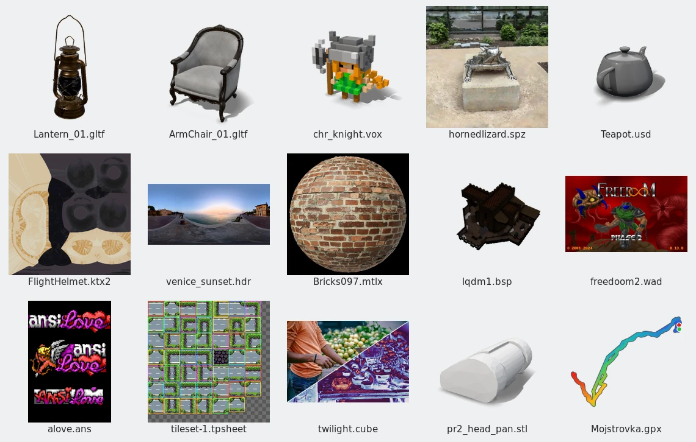
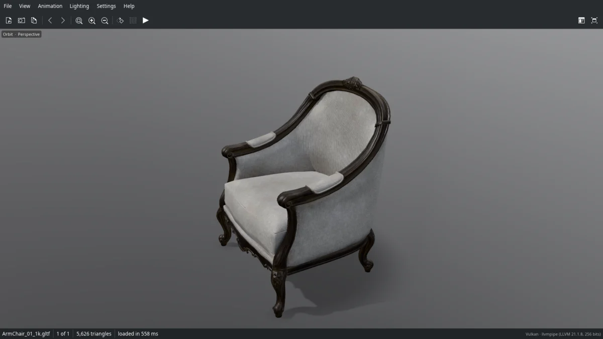
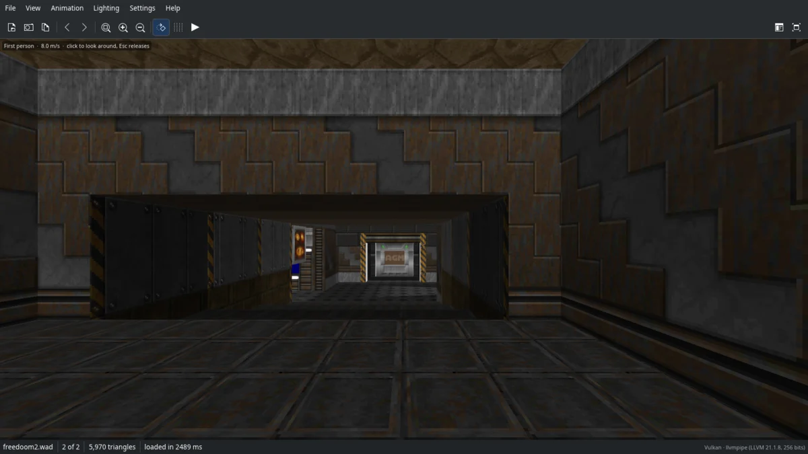
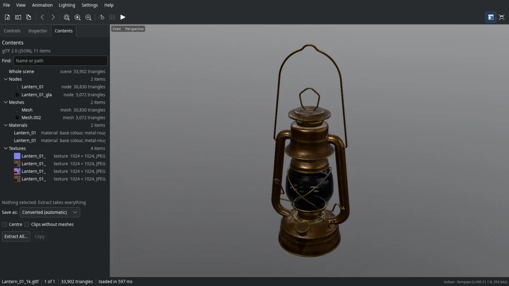
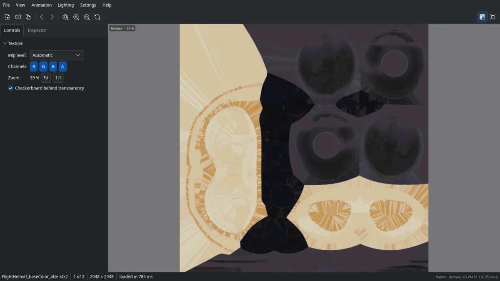

# Slerp

Slerp makes file-manager thumbnails for 3D models, game files, GPU textures and other graphics files that desktops usually show as generic icons, and opens them in a viewer.  It runs on Linux, Windows 11 and macOS.

It is a young project with one developer, and 0.1.0 is its first release.  It reads about 200 formats, but for many of them only part of what the format can hold; [docs/format-details.md](docs/format-details.md) says what each reader leaves out.  Most of the testing so far has been on one Linux laptop with KDE, a Windows 11 virtual machine and one Mac, so expect files it gets wrong.  Bug reports are welcome, most of all with a file that you're free to share.

Slerp is vibe coded.  Its developer, Eric, described what he wanted, and AI coding agents wrote all of the code, the tests included; he never looked at the code himself.



## What it does

- **Thumbnails.**  On Linux through the freedesktop thumbnailer standard, which Dolphin, GNOME Files, Nemo, Caja, Thunar and PCManFM-Qt read; on Windows in Explorer; on macOS in Finder through Quick Look.  A helper process keeps the GPU loaded between files, so a folder of models doesn't pay for starting the GPU once per file.
- **A viewer.**  It orbits around models, walks through game levels in first person, plays animations, shows a texture's mip levels and cube faces, and slices through medical volumes.  The arrow keys step through the other files in the folder, as in a picture viewer.
- **The pieces inside a file.**  The Contents panel lists what a file holds (nodes, meshes, materials, textures, clips, layers, archive entries), shows any one of them on its own, and saves or drags it out as an ordinary file.
- **Saving as glTF.**  What the viewer shows in 3D can be saved as a GLB file, from the viewer or the command line.
- **Reading files from anywhere.**  The readers check sizes and offsets, the parsers are fuzz-tested, and the riskier C decoders and the document renderers run in child processes with time and memory limits.  That lowers the risk of a bad file without ruling it out.  Slerp never goes online.
- **The desktop's look.**  The viewer takes its colours, fonts and icons from KDE, GNOME, Windows or macOS.

| | |
|---|---|
|  |  |
| A glTF model | A Doom map, in first person |
|  |  |
| The Contents panel | A KTX2 texture compressed with Basis Universal |

The pictures show freely licensed samples: Poly Haven's Lantern, ArmChair and Venice sunset sky, the USD Working Group's teapot, the Khronos FlightHelmet's texture and ambientCG's Bricks097 material (CC0); Freedoom and a LibreQuake map (BSD-3-Clause); a knight from MagicaVoxel's samples, Niantic's horned lizard splat, a Matplotlib colour table and a Ludum Dare sprite sheet (MIT); ANSI art from ansilove's examples (BSD-2-Clause), Willow Garage's PR2 head (BSD) and a GPS track from gpxpy's tests (Apache-2.0).

## What it reads

| Kind | Formats |
|---|---|
| 3D models | glTF and GLB (meshopt, Draco, quantized and Basis-textured files too), VRM, FBX, OBJ, STL, PLY, COLLADA, USD and USDZ (skinned and animated characters, blend shapes, point instancers), 3MF, 3DS, DirectX `.x`, VRML and X3D, OFF, Draco, MagicaVoxel, Blockbench |
| Applications' scenes | Blender `.blend`, SketchUp, Maya `.ma` and `.mb`, 3ds Max, Rhino `.3dm`, Godot and Unity scenes |
| Games | Quake, Half-Life and Source models and maps, Quake II and III models, Doom WADs and GZDoom's PK3 and PK7, level editors' `.map` and `.vmf` sources, MD5, IQM and IQE, SMD, Unreal PSK and PSA, MikuMikuDance PMX, PMD and VMD, Minecraft schematics, Roblox places and models, Unreal `.uasset` thumbnails, and the archives PAK, PK4, PCK, VPK, GRP and `.unitypackage` |
| Characters | MetaHuman `.dna` files, with live RigLogic face controls |
| Point clouds and splats | LAS and LAZ, E57, PCD, PTS, PTX; Gaussian splats as 3DGS PLY, `.splat`, SPZ and SOG |
| Textures | KTX2 (with Basis Universal and zstd), KTX, DDS (BC1 to BC7, and video formats such as YUY2, NV12 and P010), ASTC (2D, and 3D volume textures), PVR, PKM, BLP, XNB, Build engine tiles, Quake and Half-Life WADs |
| Materials | MaterialX, USD materials, Godot `.tres`, Substance `.sbsar` icons |
| 2D game art | Aseprite, Tiled, LDtk, Piskel, Pyxel Edit, Quake sprites, texture atlases and sprite sheets |
| Pictures | OpenEXR, Radiance HDR, Photoshop PSD and PSB, GIMP XCF, Krita, OpenRaster, JPEG XL, AVIF, HEIC, JPEG 2000, JPEG XR, animated GIF, PNG and WebP, TIFF, QOI, ICNS, ICO, SGI, PAM, farbfeld, XPM, XBM, and 16-bit heightmaps |
| Retro computer art | Amiga IFF, Atari ST and 8-bit, Commodore 64, MSX, Apple II, BBC Micro, ANSI art, PICO-8 and TIC-80 cartridges |
| Drawings and CAD | DXF, PDF, Illustrator, EPS and PostScript, SVG, Windows metafiles (WMF, EMF), Macintosh PICT |
| Stored previews | The pictures saved inside DWG, SolidWorks, Inventor, Revit, Solid Edge, Fusion, DWF, CorelDRAW, Visio, Cinema 4D, ZBrush, Procreate, Affinity, Sketch, Figma, Clip Studio Paint, Paint.NET, Paint Shop Pro, Pixelmator Pro, PaintTool SAI, InDesign, Adobe XD, FreeCAD and Apple iWork files |
| Colour | Palettes (ASE, ACO, ACT, GPL, KPL, PAL, HEX, Procreate swatches) and lookup tables (`.cube`, `.3dl`) |
| Science and medicine | DICOM, NIfTI and Analyze, NRRD, MetaImage, NumPy, HDF5 and MATLAB v7.3, NetCDF, FITS, XISF, DPX and Cineon film scans, OME-TIFF, BigTIFF and whole-slide scans |
| Paths | G-code and binary G-code toolpaths; GPX, TCX, FIT, KML, KMZ and GeoJSON tracks |

[docs/formats.md](docs/formats.md) lists all of them with their file extensions, and [docs/format-details.md](docs/format-details.md) says what each reader covers and what it leaves out.  Ordinary pictures and documents (PNG, JPEG, PDF and the like) open in the viewer, but Slerp leaves their thumbnails to the desktop's own unless you switch them on.

## Installing

Ready-made builds are on the [Releases page](https://github.com/eric-frost/slerp/releases/latest): for Windows 10 and 11 (x64), for macOS 11 or newer on Apple Silicon, and for Linux on x86_64 and arm64.  They aren't signed with a certificate, so Windows and macOS warn about them the first time; the steps are below.  `SHA256SUMS` on the same page lists their checksums, and each file has a build attestation that shows it was built from the release's source by the repository's workflow (`gh attestation verify FILE --repo eric-frost/slerp`).

### Windows

[`Slerp-Setup-windows-x64.exe`](https://github.com/eric-frost/slerp/releases/latest/download/Slerp-Setup-windows-x64.exe) installs Slerp for your account only, without administrator rights, in `%LOCALAPPDATA%\Programs\Slerp`.  It sets up Explorer's thumbnails and the "Open with" entry, and adds the viewer to the Start menu.  Because the installer isn't signed, SmartScreen says "Windows protected your PC": click "More info", then "Run anyway".  Smart App Control, when it is switched on, blocks unsigned programs outright.  Settings, Apps, Installed apps removes Slerp again and puts back any thumbnail handler it replaced.  The installer and the uninstaller also run silently, with `/VERYSILENT`.

[`Slerp-windows-x64.zip`](https://github.com/eric-frost/slerp/releases/latest/download/Slerp-windows-x64.zip) holds the same programs without an installer: `slerp.exe` (the command line and the viewer), `slerpw.exe` (opens files in the viewer without a console window) and `slerp_shell.dll` (Explorer's thumbnail handler).  Unpack them into a folder that stays put and run `slerp.exe register` there once, without administrator rights; `slerp.exe unregister` undoes it before you delete the folder.  Explorer keeps the DLL loaded, so to replace it by hand, sign out first.

### macOS

[`Slerp-macos-arm64.dmg`](https://github.com/eric-frost/slerp/releases/latest/download/Slerp-macos-arm64.dmg) holds `Slerp.app`, for Macs with Apple Silicon; drag it to Applications.  The app holds the viewer and a Quick Look extension that gives Finder thumbnails of the formats macOS doesn't know itself, which Finder starts using once the app has been opened.  The app is signed ad hoc but not notarized by Apple, so macOS blocks it the first time.  Then open System Settings, Privacy & Security, and click "Open Anyway" beside the message about Slerp.  Or install it from Terminal, which avoids the warning, since curl doesn't mark what it downloads as coming from the internet:

```
curl -fL -o /tmp/Slerp.zip \
  https://github.com/eric-frost/slerp/releases/latest/download/Slerp-macos-arm64.zip &&
  rm -rf /Applications/Slerp.app && ditto -x -k /tmp/Slerp.zip /Applications &&
  open /Applications/Slerp.app
```

The same command updates Slerp later: it replaces the app that is there.

Intel Macs aren't supported.

### Linux

Each distribution gets two packages: `slerp`, the program with its thumbnailer, MIME types, menu entry and icon, and `slerp-qt-plugin`, the optional Qt image plugin (below), kept apart so that only Qt desktops pull in Qt.  The file names below are for x86_64; on arm64 they end in `arm64.deb`, `aarch64.rpm` and `aarch64.tar.gz` instead.

- **Debian 12 or newer, Ubuntu 22.04 or newer:** `sudo apt install ./slerp_0.1.0-1_amd64.deb ./slerp-qt-plugin_0.1.0-1_amd64.deb`
- **Fedora:** `sudo dnf install ./slerp-0.1.0-1.x86_64.rpm ./slerp-qt-plugin-0.1.0-1.x86_64.rpm`
- **Arch Linux** (x86_64 only): `sudo pacman -U slerp-0.1.0-1-x86_64.pkg.tar.zst slerp-qt-plugin-0.1.0-1-x86_64.pkg.tar.zst`
- **Other distributions:** unpack `slerp-0.1.0-linux-x86_64.tar.gz` and run `sudo ./install.sh` in it, which installs under `/usr/local` (`--uninstall` removes it again).  GNOME's file managers need `sudo ./install.sh --prefix /usr`, because their thumbnail sandbox sees only `/usr`.  The program needs the Vulkan loader (`libvulkan1` or `vulkan-loader`).

The packages recommend Mesa's Vulkan drivers, whose lavapipe draws 3D thumbnails where there is no GPU driver, and suggest libheif (HEIC pictures) and Ghostscript (PostScript and EPS files without a stored preview).

### From source

Slerp needs Rust 1.93 or newer, a C and C++ compiler, libclang (for Basis Universal's transcoder) and the Wayland and xkbcommon development files.  On Debian and Ubuntu:

```
sudo apt install cargo libclang-dev libwayland-dev libxkbcommon-dev \
  pkg-config g++
cargo build --release
```

The repository's `.cargo/config.toml` builds into `local/target/`.  Then install, as root, `local/target/release/slerp` to `/usr/local/bin` or `/usr/bin`, `data/slerp.thumbnailer` to `share/thumbnailers/`, `data/slerp.xml` to `share/mime/packages/` followed by `update-mime-database`, `data/slerp.desktop` to `share/applications/` followed by `update-desktop-database`, and `data/slerp.svg` to `share/icons/hicolor/scalable/apps/`.  GNOME's thumbnail sandbox sees only `/usr`, so its file managers need the `/usr` prefix.

The viewer's heavier picture decoders are Cargo features, all on by default: `heic` (loads the system's libheif at run time), `avif` (the rav1d AV1 decoder) and `jxl` (jxl-rs).  `cargo build --release --no-default-features --features viewer,avif` keeps only the ones listed, and without `viewer` the program is a thumbnailer alone, half the size.  `--features avif-asm` adds rav1d's assembly, which decodes AV1 several times faster but needs the `nasm` assembler on x86.

The release files are made by `tools/build-linux.sh` (the Linux packages and tarball), `tools/build-windows.sh` (cross-compiles the Windows programs on Linux; the installer is `packaging/windows/slerp.iss`), `tools/macos-app.sh` (the Mac app, on a Mac) and `packaging/aur/PKGBUILD`, all run by the release workflow in `.github/workflows/release.yml`; [tools/README.md](tools/README.md) describes them.

### The Qt image plugin

`qt/` holds an optional plugin for Qt 6 that makes every Qt program that reads pictures understand Slerp's files: Gwenview opens KTX2, KTX and ASTC textures and the other formats no Qt plugin reads, and Dolphin's Information panel and Gwenview show models, levels and materials slowly turning.  The packages above include it as `slerp-qt-plugin`; to build it by hand you need CMake and `qt6-base-dev`:

```
cmake -S qt -B build-qt -DCMAKE_BUILD_TYPE=Release \
  -DSLERP_EXECUTABLE=/usr/local/bin/slerp
cmake --build build-qt --target slerp_qimage
sudo cp build-qt/plugins/imageformats/slerp_qimage.so \
  "$(qtpaths6 --query QT_INSTALL_PLUGINS)/imageformats/"
```

Qt looks only in its own plugin folder, so the plugin can't go under `/usr/local`.  Programs load it when they start, so restart Dolphin and Gwenview afterwards.  `SLERP_EXECUTABLE` is where the plugin starts Slerp's helper from when none is running (it falls back to `slerp` on the `PATH`).

### After installing: Dolphin

Most file managers pick up Slerp's thumbnailer by themselves.  Dolphin also keeps a list of enabled preview plugins, so each user who wants Slerp's thumbnails there runs this once (and again after an update that adds formats):

```
slerp associate --apply
```

It switches on "Slerp" in Dolphin's preview settings (Settings, Interface, Previews) and applies the user's choice of formats (see [Choosing file types](#choosing-file-types)).  Restart Dolphin afterwards; it reads the list when it starts.

## Using Slerp

### The viewer

`slerp view [file]` (or just `slerp file`, or "Open with" in the file manager) opens the viewer.  It picks a mode from the file: 3D models and scenes with an orbit camera, levels in first person at the player's start, textures and pictures at their own size with mips, layers, faces and channels to pick (volume textures, 3D ASTC included, a slice at a time), materials on a ball, galleries for texture packs and tile sets, documents a page at a time, and the slice view for volumes.  The side panels are tabs that start together on the left, so the view keeps most of the window: Controls for the mode (lighting and environment, the clip to play, morphs, levels of detail, a material's tiling and displacement, which update the preview while you drag, window and level for medical images, and so on), the Inspector (counts, materials, textures, skeleton, the file's own details) and Contents.  Drag a tab by its title to dock it beside the view or another panel; View, Reset Panel Layout puts them back.

| Keys and mouse | |
|---|---|
| Drag, Shift-drag, wheel | Orbit, pan, move closer; double-click orbits around the point clicked |
| Tab, then W A S D, Q E, Shift | Switch to first person and fly; Shift flies faster |
| F, Home | Frame the model or fit the picture; reset the view |
| 1, 3, 7 (Ctrl: opposite side), 5 | Front, side and top views; orthographic or perspective |
| Space, [ and ], comma and period | Play or pause, previous or next clip, step a paused clip by a frame |
| Page Up, Page Down, Alt+Left, Alt+Right | Previous or next file in the folder |
| F9, F11, Ctrl+M | Side panels, full screen, menu bar |
| Ctrl+Shift+S, Ctrl+Shift+C | Save a screenshot, copy the view state |
| F5 | Reload the file |

F1 (Help, Keyboard Shortcuts) lists every shortcut.  In the panels, a clicked control keeps the keyboard, as in Qt: the arrow keys step a combo box (the Doom map picker, Show, Level of detail) without opening it, step a slider, and move a list's selection, and the mouse wheel over a combo box steps it.  The arrow keys and Page Up and Page Down step through files only while the 3D view has the keyboard; clicking the view or pressing Escape gives it back.

The viewer watches the open file and the files it read beside it (a glTF's `.bin` and textures, an OBJ's `.mtl`, a map's WADs).  When an exporter or editor saves one, a bar offers to reload it, and reloading keeps the camera, the clip and its time, morphs and the texture view; View, Always Reload does it without asking.  Animation, Add Animations from File plays the clips of an animation library on the character shown, matched by joint names or retargeted between humanoid skeletons.  Foot IK keeps planted feet in place when the character's legs are proportioned differently from the clip's; the Foot IK check box beside Add Animations switches it.

### The pieces inside a file

Files with pieces inside get a Contents panel.  Game archives and Unity packages list their entries (a WAD's lumps in their namespaces and map folders, a PK3's folders, a Unity package's assets under their project paths), and the selected entry shows in the view: Doom pictures, flats and sprites with their offsets, sounds as waveforms, text as text, models and maps as they are.  Every other file lists its pieces: a model's nodes, a Blender file's collections (as folders of their objects), meshes (with their blend shapes), materials, textures, clips, skeletons, VRM expressions, glTF cameras and lights; a MetaHuman's levels of detail and rig controls; a texture's mip levels, array layers and cube faces, and a cube map as one panorama; the layers, frames and tags of sprites, tile maps and layered pictures; an EXR's layers and a PDF's pages; the picture an authoring program saved in the file; and the member files of zip-based formats.  Clicking a piece shows it in the file that is open (a node or mesh alone and framed, a clip playing, a blend shape at full weight, a mip, layer or face picked), and hovering one outlines it in the 3D view.  Rows carry small pictures: pictures are shrunk, and meshes, nodes and collections are drawn on the GPU in the background (not for files of more than 2,000 meshes).

Extract writes the selection as ordinary files, Ctrl+C copies it for pasting in a file manager, and it can be dragged out of the window.  Pictures embedded in a model come out exactly as stored, other pictures as PNG (or OpenEXR when their values go beyond 0 to 1), meshes, nodes, collections, materials (on a ball), skeletons and clips as GLB, a cube map's panorama as PNG (or OpenEXR when it is floating point), sounds as WAV and music as MIDI.  Things that only mean something inside their file (cameras, blend shapes, rig controls) are listed but not saved.  "Open in SLADE" or "Open in VPKEdit" appears for archives when one is installed: Slerp reads and extracts files but never changes them.

### Converting to glTF

File, Save as GLB in the viewer writes the 3D scene it shows (with clips added from animation libraries), and `slerp convert` does the same from the command line.  Nodes, meshes of every kind, materials with the glTF extensions Slerp reads, skins, named morph targets and clips are written; pictures keep their original PNG, JPEG, Basis KTX2 or WebP files where the source held one, else become PNG.  What glTF can't hold is approximated and reported: floating-point pictures become 8-bit, Quake lightmaps occlusion maps, Doom's sprites crossed quads, Gaussian splats coloured points, and hidden objects stay hidden through `KHR_node_visibility`.  The tests check the files it writes with the Khronos glTF Validator.

### The command line

```
slerp view [FILE]                                   # the viewer
slerp thumbnail SIZE INPUT OUTPUT.png               # what file managers run
slerp render INPUT OUTPUT.png [--size N] [--state view.jsonc] [--content]
slerp info FILE [--part MAP07]                      # what a file holds
slerp convert INPUT OUTPUT.glb [--part MAP01] [--centre] [--png]
slerp contents list FILE
slerp contents extract FILE [ITEM...] --out DIR [--format FORMAT] [--centre]
                    [--skeleton-only] [--force]
slerp associate --list                              # see "Choosing file types"
slerp formats                                       # the table of formats
```

`render` draws one frame offscreen, optionally replaying a view state the viewer copied (camera, clip and time, morphs, overlays; Ctrl+Shift+C); without one, a file that carries a picture of itself gives that picture, as its thumbnail does, unless `--content` asks for the file's content.  `--part` picks one part of a file that has several, such as a WAD's maps.  `contents extract` takes items as paths, names, folders or globs (all of them when none is named), converts them as `--format` says (`auto`, `raw`, `png`, `exr`, `wav`, `mid`, `wad` or `glb`), and never writes outside `--out` or over an existing file without `--force`.

### Choosing file types

Slerp knows more than 200 formats (`slerp associate --list` shows them).  For each, two choices: whether Slerp makes the file manager's thumbnails, and whether Slerp opens it by default.  Thumbnails are on for everything Slerp reads that the desktops can't preview, and off for ordinary pictures (PNG, JPEG, GIF, WebP, TIFF, AVIF, HEIC, JPEG XL and the like), which KDE and GNOME already draw.  Slerp never makes itself the default app on its own: it is offered in "Open with" (below the usual image viewers for ordinary pictures), and the desktop may still pick it where nothing else opens a type.

Change them in the viewer under Settings, File Types (formats grouped by category, a search box, a switch for each row and each category, and what makes each format's thumbnails and opens it on this computer now), or on the command line:

```
slerp associate --list                      # formats, choices, handlers
slerp associate --thumbnails off dds retro  # formats, categories or all
slerp associate --default on glb vrm        # Slerp opens these by default
slerp associate --replace-kde on dds        # KDE only: see below
slerp associate --apply                     # apply the choices again
slerp associate --reset                     # undo every change outside Slerp
```

Every command takes `--dry-run`.  The choices live in `file-types.jsonc` beside `config.jsonc`, listing only where they differ from Slerp's defaults.  What applying changed outside Slerp's own files is recorded in `~/.local/state/slerp/file-types-applied.json` (`%LOCALAPPDATA%\Slerp` on Windows), so `--reset` puts back exactly what was there, other programs' defaults and thumbnail handlers included; when another program changed an entry since, Slerp leaves that entry alone, and a default app you pick elsewhere switches Slerp's "open by default" off for that format.

- **Linux.**  Slerp writes `~/.local/share/thumbnailers/slerp.thumbnailer` with the chosen types, which hides the system-wide one in Dolphin, Thunar and PCManFM-Qt, and adds Slerp to Dolphin's preview plugins.  GNOME's thumbnail factory (Nautilus, and its copies in Nemo and Caja) reads every thumbnailer file rather than hiding one by name, so where one of those is installed Slerp also writes small per-user files that claim the switched-off types first: a copy of the thumbnailer that would come next (glycin's, say), or one that makes nothing.  Default apps go in `~/.config/mimeapps.list`, which KDE and GNOME both read.  Cached thumbnails of the types that changed are cleared; restart Dolphin to see the change, since it reads its plugin list when it starts.
- **KDE's own plugins win.**  KIO always prefers KDE's compiled thumbnail plugins over thumbnailer files for the types they claim, so Dolphin keeps KDE's previews of DDS (`imagethumbnail`, which can't decode BC6H, BC7 or ASTC), Blender files (`blenderthumbnail`) and 3MF (`opendocumentthumbnail`) whatever Slerp's switch says.  `--replace-kde on` (or the check box under the format in File Types) switches that KDE plugin off in Dolphin's preview settings so Slerp's are used; the plugin then previews none of its other types either (for `imagethumbnail`: PNG, GIF, WebP, TIFF, BMP and more) unless Slerp's thumbnails are on for them.
- **Windows.**  Explorer's thumbnail handler is registered per user only for the chosen extensions; one another program had registered for an extension is put back when Slerp's is switched off.  Windows protects each user's default app with a hash that only its own Settings may write, so Slerp can only offer itself in "Open with" and list its types under Settings, Apps, Default apps, Slerp, which `--default on` opens for you to choose.  `slerp register` applies the choices too.
- **macOS.**  Quick Look asks Slerp's extension for every type it declares, so the extension reads the choices itself and declines the formats switched off (with all of them off, the extension is switched off).  Default apps are set through LaunchServices, which remembers the app each type had before.  Quick Look keeps the types macOS declares itself for Apple's own thumbnailers.
- The Qt image plugin (Gwenview, Dolphin's Information panel) leaves alone the formats whose thumbnails are switched off.

### Settings

`~/.config/slerp/config.jsonc` (`%APPDATA%\Slerp\config.jsonc` on Windows, `~/Library/Application Support/Slerp/config.jsonc` on macOS), all optional:

```jsonc
{
  // "auto" (the desktop's GPU), "integrated", "discrete", "software",
  // or part of an adapter name.  Integrated GPUs start fastest.
  "gpu": "integrated",
  // The viewer draws a window, so it stays on the desktop's GPU.
  "viewerGpu": "auto",
  // Seconds the helper stays loaded after its last thumbnail.
  "helperIdleSeconds": 120,
  // Seconds the viewer stays loaded after its last window closes, so
  // the next `slerp view` opens at once; 0 turns it off.
  "viewerKeepAliveSeconds": 30,
  // Linux: while the thumbnail helper runs, a viewer stays loaded too,
  // so the first file opened from the file manager opens at once.
  "viewerWithHelper": true,
  // Megabytes of a volume (NIfTI, NRRD, TIFF stack, HDF5 array) the viewer
  // holds in memory; bigger ones are read from the file a plane at a time.
  "volumeMemoryMb": 1024,
  // Megabytes of decoded animation frames (GIF, APNG, WebP, AVIF, JPEG XL)
  // the viewer keeps; frames beyond that are decoded again when shown.
  "imageMemoryMb": 512
}
```

`SLERP_GPU` overrides `gpu` for one run, `SLERP_VIEWER_KEEP_ALIVE` overrides `viewerKeepAliveSeconds`, `SLERP_VOLUME_MEMORY_MB` overrides `volumeMemoryMb`, and `SLERP_IMAGE_MEMORY_MB` overrides `imageMemoryMb`.  On Windows and macOS, `integrated` and `discrete` ask the system for its low-power or high-performance GPU, `software` is Direct3D's WARP renderer (Windows only), and `WGPU_BACKEND` picks another graphics API (Windows falls back to Vulkan when Direct3D 12 has no adapter).

## How it works

- File managers run `slerp thumbnail SIZE INPUT OUTPUT` through a freedesktop `.thumbnailer` file (`data/slerp.thumbnailer`), with the MIME types from `data/slerp.xml`.  Both, the desktop entry, the macOS property lists and the Qt plugin's list are generated from one table of formats (`crates/formats/src/table.rs`).
- Textures and pictures decode on the CPU.  Models, levels and materials render on the GPU with Slerp's own renderer on wgpu: Vulkan on Linux, Direct3D 12 on Windows (its WARP software renderer when there is no GPU), Metal on macOS.  It shades glTF's physically based materials, glass that refracts what is behind it included, with ambient occlusion in creases, draws point clouds as solid dots and splats sorted on the GPU, and leaves the baked light of Quake and Doom levels untouched by tone mapping.
- Starting a GPU costs 100 to 800 ms, so the first thumbnail starts a per-user helper process that keeps the GPU loaded and renders later thumbnails in a few milliseconds each.  It exits after two idle minutes.  In GNOME's thumbnail sandbox, which hides the GPU, Slerp renders on lavapipe, Mesa's CPU Vulkan driver.
- The viewer starts its GPU first, since the driver takes longest, and meanwhile opens its window in the desktop theme's colours and reads the theme and the file.  It draws a model before all its textures are on the GPU, and keeps Basis Universal textures compressed there.  After its last window closes it stays loaded for 30 seconds (`viewerKeepAliveSeconds`, or Settings, Stay Loaded After Closing), and on Linux the thumbnail helper starts one that stays loaded while the helper runs (`viewerWithHelper`, or Settings, Get Ready While Browsing), so files open in a few tens of milliseconds instead of a few hundred (on the laptop it was measured on).  A MetaHuman `.dna` file opens about twice as fast the second time, from a cache in `~/.cache/slerp/dna/`.
- Readers treat every file as untrusted: sizes and offsets are checked, allocations are capped, and damaged files give a message, not a crash.  The parsers are fuzzed with cargo-fuzz (`fuzz/`).  The riskier decoders (Microsoft's jxrlib, Epic's DNA reader, the AV1 decoder, the system's libheif) and the PDF and SVG renderers run in separate processes with time and memory limits: forked children on Linux and macOS, a second `slerp.exe` on Windows.  A crash, a hang or a runaway allocation there costs one picture and gives a message.
- The Qt image plugin decodes and renders nothing itself: it asks the helper, so no GPU driver or file parser runs inside Dolphin or Gwenview.  Textures read as pictures at their own size; models, levels and materials as a 36-frame turntable, fetched only when a program reads a second frame.  Anything that goes wrong (no helper, a broken file) means no picture or an animation that stops, within 2.5 s at worst, never a crash or a hang.  [docs/qt-plugin.md](docs/qt-plugin.md) has the details.

## Development

[ARCHITECTURE.md](ARCHITECTURE.md) describes the crates and their conventions.  `cargo test --workspace` runs the tests; many of them read the public test corpus, which `deno run -A tools/fetch-test-assets.ts` downloads into `local/assets/` (about 2 GB; tests skip what's missing).  `tools/kio-probe/` asks KDE for thumbnails the way Dolphin does, and `tools/README.md` describes the other tools.  After changing the format table, `slerp formats --write` rewrites the files generated from it and `cargo run --manifest-path tools/format-list/Cargo.toml` rewrites [docs/formats.md](docs/formats.md); `cargo test -p slerp-formats` fails while a generated file is out of date.  `deno run -A tools/third-party.ts` refreshes [THIRD-PARTY.md](THIRD-PARTY.md) after dependencies change, and `tools/readme-images.sh` makes the pictures above.

Packaging: `.github/workflows/release.yml` builds and smoke-tests every release file and makes a draft release from a `v*` tag.  It runs `tools/build-linux.sh` (deb, rpm and tarball), `packaging/aur/PKGBUILD` with `tools/source-tarball.sh` (Arch Linux), `tools/build-windows.sh` with `packaging/windows/slerp.iss`, and `tools/macos-app.sh`; `tools/test-packages.sh deb|rpm|arch|aur|tar` installs and tests the Linux files in fresh containers.

## Licence

Slerp is licensed under either of the [MIT licence](LICENSE-MIT) or the [Apache License 2.0](LICENSE-APACHE), at your option.  Unless you say otherwise, any contribution you submit for inclusion in Slerp is licensed the same way, without any additional terms or conditions.

Slerp includes work by others under their own permissive licences: Epic Games' openriglogic (MIT), Microsoft's jxrlib (BSD-2-Clause), the SketchUp file layouts of OpenSKP (MIT), the Quake and Doom palettes of LibreQuake and Freedoom (BSD-3-Clause), Lucide's icons (ISC), the Unscii and Hershey fonts (public domain), two CC0 photos, Matplotlib's colour maps, and shading ported from the Khronos glTF Sample Renderer (Apache-2.0).  It is built on several hundred Rust crates, among them hayro, whose PDF fonts come from PDFium (BSD-3-Clause), and egui, whose fonts are under the SIL Open Font License and the Ubuntu Font Licence.  [THIRD-PARTY.md](THIRD-PARTY.md) lists them all with their notices; the packages install it beside the README.
